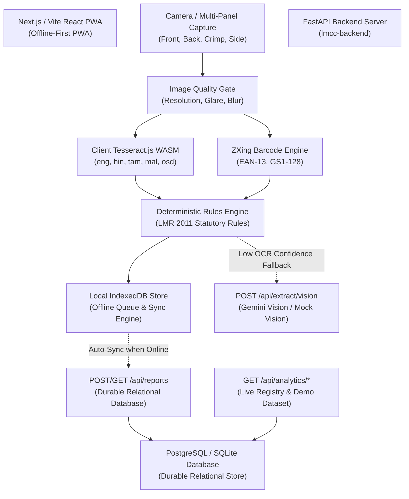

# JAMEx / LMCC — Product Discovery & Requirements Assessment

**Document ID:** `JAMEX_PRODUCT_DISCOVERY`  
**Repository:** `jisssz/JAMEx-LMCC`  
**Target Environments:**
- Frontend: [https://lmcc-web-ten.vercel.app](https://lmcc-web-ten.vercel.app)
- Backend API: [https://lmcc-backend.vercel.app](https://lmcc-backend.vercel.app) (Shared Prototype) / Dedicated Backend
- API Documentation: [https://lmcc-backend.vercel.app/docs](https://lmcc-backend.vercel.app/docs)

---

## 1. Executive Problem Statement

In India, the **Legal Metrology (Packaged Commodities) Rules, 2011 (LMR 2011)** mandate that every pre-packaged commodity sold to consumers must display five core statutory declarations:
1. **Rule 6(1)(da):** Maximum Retail Price (MRP) inclusive of all taxes, with explicit standard currency prefixes (`₹` or `Rs.`) and unit sale pricing (Rule 6(11)).
2. **Rule 6(1)(c):** Net quantity in standard metric units (g, kg, ml, l, cm, m, numbers) with required spacing and decimal conventions.
3. **Rule 6(1)(d):** Month and year of manufacture/packing/import, with statutory prefix (`MFD`, `PKD`, `IMP`) and strict prohibition of post-dated declarations.
4. **Rule 6(1)(a):** Name and full address of manufacturer, packer, or importer (including postal PIN code).
5. **Rule 6(1)(e):** Consumer care helpline details, including phone/toll-free number, email, or postal grievance redressal address.

Field inspectors and market surveillance officers currently inspect packages manually in retail stores and distribution hubs. This manual process is:
- **Labor-intensive & slow:** Verifying 5 multi-part rules across thousands of SKUs in warehouses takes minutes per package.
- **Error-prone:** Dot-matrix crimp stamps, reflective foil glare, Devanagari numerals, and fractured multi-panel layouts lead to missed violations.
- **Disconnected:** Inspection findings in local markets rarely sync automatically with central market surveillance intelligence databases or exportable audit trails.

**JAMEx / LMCC** solves this by providing an offline-first Progressive Web App (PWA) equipped with on-device multilingual OCR (English, Hindi, Tamil, Malayalam), multi-panel image aggregation, barcode cross-checks, deterministic legal metrology rule screening, AI-assisted vision fallback for degraded stamps, and an executive authority surveillance dashboard.

---

## 2. Intended User Personas & Primary Journeys

### Persona A: Field Enforcement Inspector (Legal Metrology Department)
- **Goal:** Rapidly scan packages during warehouse, supermarket, or port-of-entry inspections; document non-compliant labels with evidence; generate official inspection reports on site.
- **Environment:** Low/no internet connectivity, variable lighting, camera held in hand over varied packaging forms (pouches, bottles, cans, boxes).
- **Critical Journey:**
  1. Opens PWA in offline or online mode.
  2. Multi-panel scan: Front panel (Brand, Net Qty), Back panel (Manufacturer, Consumer Care), Crimp/Base (MRP, MFD/PKD stamp).
  3. Image quality gate alerts inspector if glare or blur is detected before processing.
  4. Local OCR extracts text; deterministic Rules Engine flags non-compliant or missing declarations with exact Gazette citations (`G.S.R. 629(E)`).
  5. If OCR is degraded, triggers AI Vision extraction fallback for human review.
  6. Inspector reviews findings, edits fields if necessary, and downloads official PDF / CSV inspection certificate with embedded legal citations.
  7. Report saves to local IndexedDB queue and automatically syncs to central registry when network is restored.

### Persona B: Brand Compliance & Packaging QA Specialist
- **Goal:** Audit artwork and physical packaging proofs prior to nationwide distribution to prevent regulatory seizure, penalties, or product recalls.
- **Critical Journey:**
  1. Uploads high-resolution label proof files (JPEG/PNG).
  2. Runs automated statutory compliance screening.
  3. Inspects field-level evidence localization (bounding boxes and exact string match).
  4. Exports structured compliance audit report.

### Persona C: Market Surveillance Authority & Regulatory Directors
- **Goal:** Monitor regional non-compliance trends, identify repeat-violator brands, analyze common defect categories (e.g., missing consumer care vs. improper MRP format), and direct enforcement resources efficiently.
- **Critical Journey:**
  1. Views Authority Dashboard.
  2. Toggles between Live Registry and Demonstration Reference Dataset.
  3. Analyzes KPI cards: Total Screenings, Compliance Rate, Pending Reviews, Violations Detected.
  4. Reviews category breakdowns (Food/Beverages, Personal Care, Household, Electronics) and issue distributions.
  5. Exports compliance intelligence summaries to CSV / PDF.

---

## 3. Current System Capabilities & Technical Architecture

### Confirmed Working Capabilities:
1. **Multi-Panel Label Aggregation:** Ingests up to 4 packaging panels (Front, Back, Crimp/Base, Side) and merges extracted statutory declarations without cross-panel text contamination.
2. **Deterministic Statutory Rules Engine:** 100% rule validation code covered by automated tests for:
   - Rule 6(1)(da) & Rule 6(11): Maximum Retail Price & Unit Sale Price
   - Rule 6(1)(c): Standard metric Net Quantity units & decimal rules
   - Rule 6(1)(d): Date of manufacture/packing/import with post-date protection
   - Rule 6(1)(a): Manufacturer/Packer identity & postal address verification
   - Rule 6(1)(e): Consumer care telephone, email, and postal grievance details
3. **Dual Data Modes (Demo vs Live):** Authority Dashboard cleanly distinguishes between the 10-report Illustrative Reference Dataset (`isDemo=true`) and live persisted inspection submissions (`isDemo=false`).
4. **Formula-Injection-Safe Exports:** CSV export protects spreadsheet users by escaping `=`, `+`, `-`, `@`, `\t`, `\r`. Vector PDF export generates multi-page inspection certificates with Gazette citations.
5. **AI Vision Fallback Quality Gate:** Backend `POST /api/extract/vision` supports structured JSON extractions; client-side fallback safely reconciles AI facts through the deterministic rules engine.

---

## 4. UI/UX Pain Points & Modernization Opportunities

1. **Current UI Feel:** While functional and dark-themed, the existing layout uses basic Tailwind utility classes without a cohesive design system, unified component primitives, or smooth transitions.
2. **Authority Dashboard Density:** Key surveillance indicators (compliance trends, issue breakdown, brand frequency) need refined Bento Grid organization, smooth hover states, and responsive data visualization cards.
3. **Scan Journey Friction:** The multi-panel scanning flow should provide crisp, animated visual states (active panel indicator, OCR processing feedback, camera viewfinder guide).
4. **Accessibility & Component Primitives:** The application lacked standard, accessible Radix-ui primitives (accessible modal dialogs, accessible dropdown menus, focus rings, keyboard tabs, and tooltip popovers).
5. **Motion Experience:** Absence of restrained entrance motions and layout transitions makes page switches feel abrupt. Motion should elevate perceived responsiveness and guide user attention.

---

## 5. Architectural & Security Boundaries

- **Zero-PII Compliance:** Inspection payloads, reports, and analytics contain zero personal data or full-resolution binary consumer images; only statutory declaration facts and compliance issue codes are stored.
- **Deterministic Legal Integrity:** LLMs / AI models are **strictly restricted** from declaring packages compliant or non-compliant. AI is used solely for visual text extraction fallback. All legal verdicts (`PASS` vs `REVIEW`) are computed deterministically by verified statutory rule algorithms.
- **Offline Resiliency:** Field inspectors must be able to inspect packages, calculate compliance verdicts, and download inspection PDF/CSV certificates completely offline in the browser.
