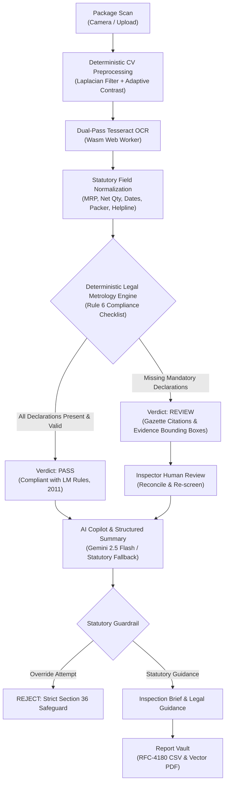
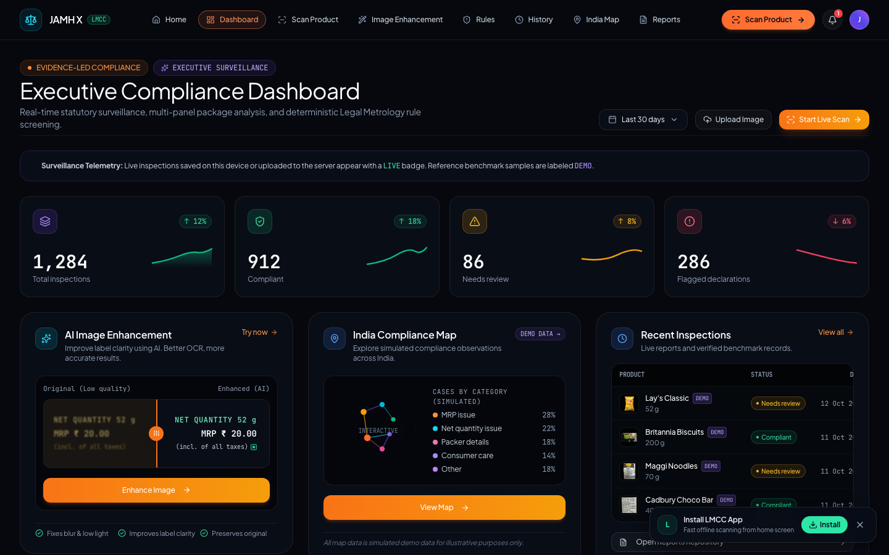
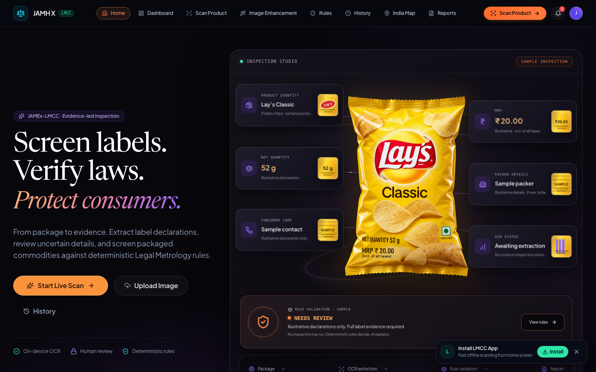
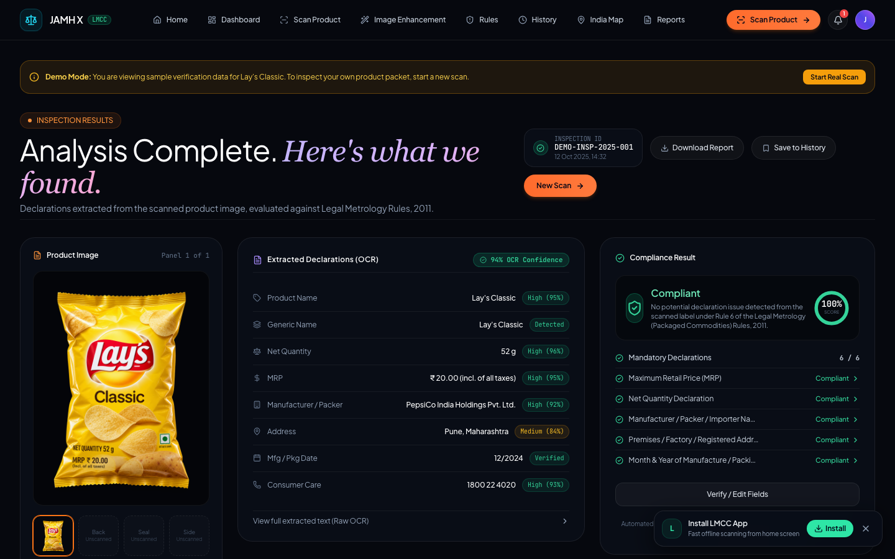
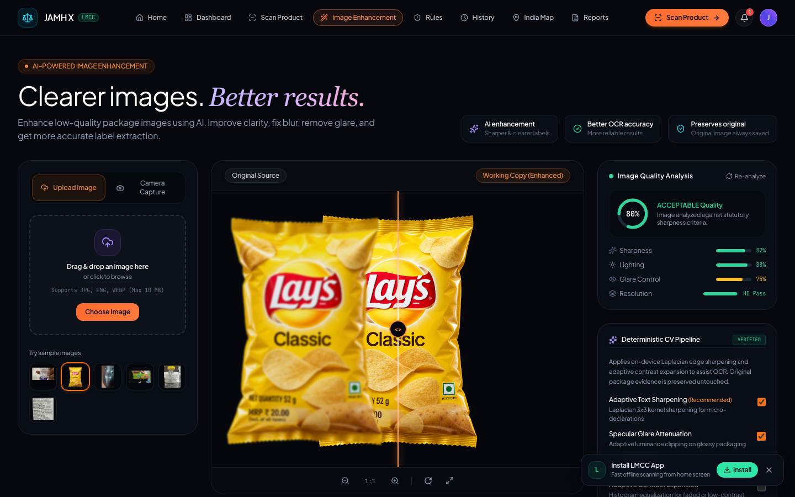
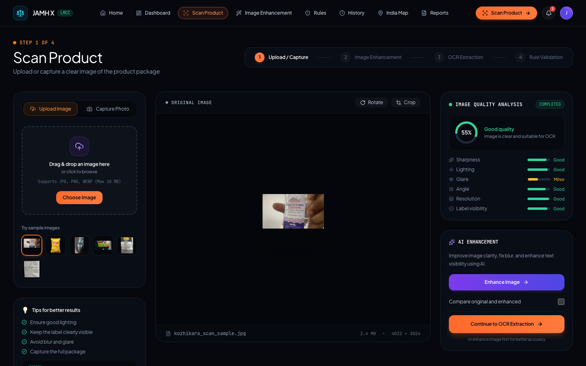
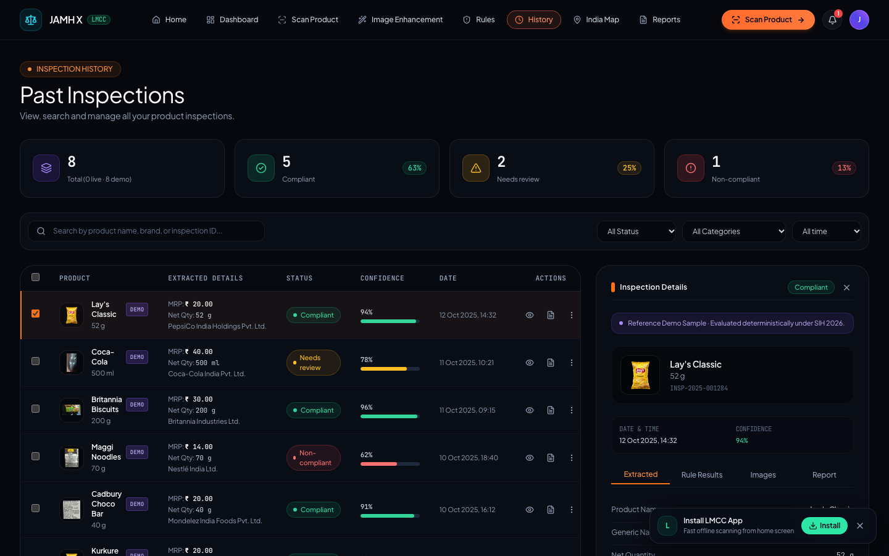
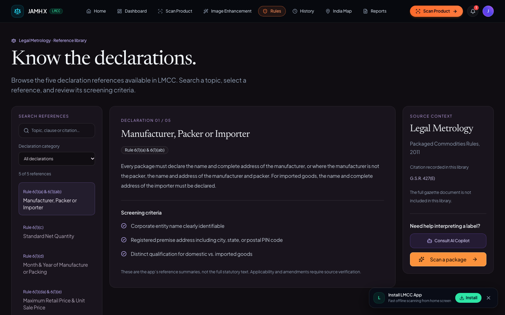
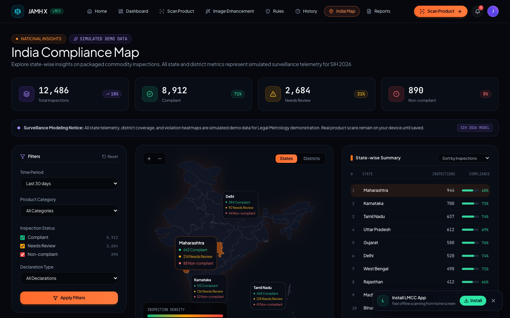
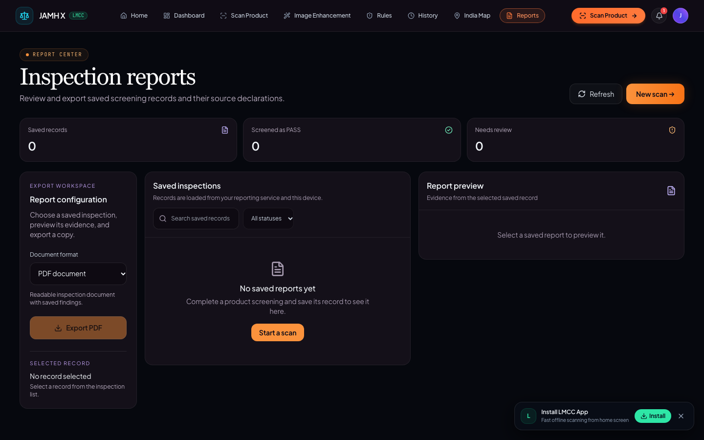

# JAMH X — Legal Metrology Compliance Checker (LMCC)

> **Autonomous Statutory Surveillance & Package Declaration Verification Engine**  
> *Built for AIBoomi Startup Weekend, Kochi • Team: JAMH X*

[](https://lmcc-web-ten.vercel.app/)
[](https://lmcc-backend.vercel.app/api/health)
[](lmcc-web/tests)
[](LICENSE)

**Live Application:** [https://lmcc-web-ten.vercel.app/](https://lmcc-web-ten.vercel.app/)  
**GitHub Repository:** [https://github.com/jisssz/JAMEx-LMCC](https://github.com/jisssz/JAMEx-LMCC)  
**API Endpoint:** [https://lmcc-backend.vercel.app](https://lmcc-backend.vercel.app)  

---

## 1. Project Overview & Tagline

**JAMH X** is an offline-first, client-side intelligence platform designed to screen packaged commodities against statutory Indian Legal Metrology requirements under **Rule 6 of the Legal Metrology (Packaged Commodities) Rules, 2011**.

> *"Transforming statutory commodity inspection from hours of manual scrutiny into seconds of transparent, evidence-grounded legal screening."*

---

## 2. Problem Statement

Checking mandatory declarations on packaged commodities across retail and distribution supply chains is critical for consumer protection, fair trade, and revenue collection. However, enforcement officers and compliance teams face severe bottlenecks:

- **Information Density & Clutter:** Mandatory declarations (MRP, Net Quantity, Manufacturer/Packer identity, Manufacturing Date, Consumer Care contacts) are distributed across irregular packaging geometries, contrasting backgrounds, and tiny fonts.
- **Physical Glare & Degradation:** Packaging labels in retail environments suffer from reflective foil glare, motion blur, crinkling, low shelf lighting, and dot-matrix stamp fading.
- **Manual Auditing Bottlenecks:** Manual inspection requires cross-referencing multiple Gazette amendments (`G.S.R. 202(E)`, `G.S.R. 359(E)`, `G.S.R. 629(E)`, `G.S.R. 779(E)`), calculating permissible error thresholds, and recording violations manually.
- **Ambiguity & Hallucination Risks:** Generic AI vision models often hallucinate prices or confuse barcodes and FSSAI licenses with mandatory statutory fields, creating unacceptable legal risk for enforcement agencies.

---

## 3. Our Solution

**JAMH X** provides an end-to-end compliance screening and decision-support workspace:

1. **Deterministic Edge Computer Vision:** Pre-processes commodity photographs directly in the browser using Laplacian sharpening, contrast expansion, and adaptive binarization to recover degraded label text without transmitting binary image data.
2. **Client-Side Optical Character Recognition:** Executes localized OCR via Tesseract.js in WebAssembly Web Workers with a dual-pass contrast fallback strategy.
3. **Statutory Rules Engine:** Applies deterministic regex normalization and rule verification against the Legal Metrology Rules, 2011. Violations are flagged with exact Gazette citations and OCR bounding coordinates.
4. **AI-Assisted Legal Copilot & Summarization:** Integrated with Google Gemini (with deterministic client-side fallbacks) to deliver plain-language inspection summaries and statutory legal assistance.
5. **Enforcement Export Pipeline:** Generates injection-sanitized RFC-4180 CSV logs and vector PDF inspection certificates for official proceedings.

> **Legal Disclaimer:** JAMH X is an automated screening and decision-support prototype intended for preliminary inspection and audit workflows. It is not an official government certification service or court-admissible legal tribunal.

---

## 4. Key Features & Implementation Status

| Feature Area | Description | Implementation Status |
| :--- | :--- | :---: |
| **Multi-Panel Scanner** | Browser camera acquisition or file drag-and-drop for multi-surface packages (Front, Back, Sides, Top, Bottom) with dimension inputs. | **Functional (100% Client-Side)** |
| **Deterministic CV Pipeline** | HTML5 Canvas-based Laplacian sharpening, luminance equalization, and live quality metrics (sharpness score, mean luminance, glare %). | **Functional (Verified)** |
| **Dual-Pass OCR Engine** | WebAssembly Tesseract.js worker with standard pass and high-contrast binarization fallback for dot-matrix stamps. | **Functional (Offline Ready)** |
| **Statutory Field Extraction** | Regular expression parsers for MRP (₹, Rs., decimal noise), Net Quantity (units, spacing), Dates, Mfg/Packer details, and Helpline. | **Functional (Verified)** |
| **Rule 6 Screening Engine** | Deterministic rule screening under Rule 6(1)(a-f). Missing mandatory fields strictly result in `REVIEW` verdicts. | **Functional (Rule-Governed)** |
| **Evidence-Linked Findings** | Interactive bounding boxes mapping extracted declarations to original package coordinates with confidence indicators. | **Functional (Verified)** |
| **Human Review & Re-Screening** | Slide-out review drawer enabling inspectors to correct OCR misreads, resolve multi-panel discrepancies, and rerun rules instantly. | **Functional (Interactive)** |
| **AI Summary & Legal Copilot** | Gemini 2.5 Flash API integration for structured inspection briefs and Section 36 penalty Q&A, backed by a deterministic statutory fallback engine. | **Functional (Dual Mode / Fallback)** |
| **Surveillance History** | Searchable local and server inspection ledger with reactive category/date filtering and clear `LIVE` vs `DEMO` badges. | **Functional (Reconciled)** |
| **Executive Dashboard** | Real-time surveillance telemetry, dynamic trend sparklines, before/after split comparison slider, and national surveillance breakdown. | **Functional (Dynamic + Baseline)** |
| **Evidence Report Vault** | CSV export protected against spreadsheet formula injection (`=`, `+`, `-`, `@`) and vector PDF inspection certificates. | **Functional (RFC-4180 & Vector PDF)** |
| **India Compliance Map** | Geographic surveillance model visualizing state-level compliance rates and commodity violation distribution. | **Simulated Demo Modeling** |

---

## 5. How It Works



1. **Acquisition & CV Preprocessing:** The user captures or uploads packaging panels. Client-side canvas shaders compute sharpness, luminance, and glare metrics, applying adaptive contrast expansion and Laplacian sharpening to create a clean working copy.
2. **Dual-Pass Extraction:** Tesseract.js executes Pass 1. If text quality or confidence is degraded, Pass 2 applies aggressive Otsu binarization to recover faint stamps.
3. **Field Normalization & Adversarial Filtering:** Regex patterns extract statutory entities while filtering out deceptive noise (e.g., distinguishing 13-digit EAN barcodes from phone numbers, or 14-digit FSSAI licenses from MRP values).
4. **Deterministic Rule Screening:** Extracted fields are matched against statutory checklists (Rules 6, 7, 8, 9, 10). Missing or non-compliant fields trigger an immediate `REVIEW` verdict with official Gazette citations.
5. **AI Summarization & Safe Copilot:** Grounded inspection facts are supplied to the Gemini LLM to generate an executive briefing. If the API is unreachable, the deterministic statutory engine seamlessly handles the request. Prompt injections or requests to override legal verdicts are strictly rejected under Section 36 safeguards.
6. **Persistence & Export:** Completed inspections are queued locally in IndexedDB and synchronized with the backend database (`reports.db`). Inspectors can export audit-ready PDF and CSV files.

---

## 6. Technology Stack

### Frontend Architecture
- **Framework:** React 18.3.1 with TypeScript (~5.6.3)
- **Build Tool:** Vite 6.0.3 (PWA enabled with Workbox service worker)
- **Styling & UI:** Tailwind CSS 3.4.16, Radix UI primitives, Framer Motion 14.6.0, Lucide React icons
- **3D Visualization:** OGL (WebGL lightweight 3D packaging canvas in Inspection Studio)
- **Client-Side OCR & CV:** Tesseract.js 5.1.1 (WebAssembly Web Worker), HTML5 Canvas 2D image processing, `@zxing/library` 0.23.0
- **Document Generation:** `jspdf` 4.2.1 (Client-side vector PDF generation)
- **Storage:** IndexedDB (`idb` wrapper) for offline inspection queue and LocalStorage for user preferences

### Backend Architecture
- **Framework:** FastAPI 0.104+ running on Uvicorn ASGI server
- **Language:** Python 3.9+
- **Database & ORM:** SQLAlchemy 2.0+ with SQLite (local) and PostgreSQL support (`psycopg2-binary`)
- **Validation:** Pydantic v2 schemas enforcing strict `PASS` / `REVIEW` verdict integrity
- **HTTP Client:** HTTPX 0.25.1 for external service communication
- **AI Service:** Google Gemini API (`gemini-2.5-flash` / `gemini-3.5-flash-lite`) with client/server statutory fallbacks

### Deployment & Infrastructure
- **Frontend Hosting:** Vercel Production Edge ([`lmcc-web-ten.vercel.app`](https://lmcc-web-ten.vercel.app/))
- **Backend Hosting:** Vercel Serverless Functions ([`lmcc-backend.vercel.app`](https://lmcc-backend.vercel.app))
- **Testing Suites:** Node.js native test runner via `tsx --test` (Frontend) and Pytest 8.4+ (Backend)

---

## 7. System Architecture

```
┌────────────────────────────────────────────────────────────────────────┐
│                        CLIENT BROWSER (PWA)                            │
│                                                                        │
│  ┌───────────────────────┐         ┌────────────────────────────────┐  │
│  │   UI & Routing        │         │   Deterministic CV Engine      │  │
│  │   (React 18 + Vite)   │         │   (Laplacian / Contrast / Wasm)│  │
│  └───────────┬───────────┘         └───────────────┬────────────────┘  │
│              │                                     │                   │
│              ▼                                     ▼                   │
│  ┌───────────────────────┐         ┌────────────────────────────────┐  │
│  │   Multi-Panel State   │◄───────►│   Tesseract.js OCR Worker      │  │
│  │   (Active Inspection) │         │   (WebAssembly Thread)         │  │
│  └───────────┬───────────┘         └────────────────────────────────┘  │
│              │                                                         │
│              ▼                                                         │
│  ┌──────────────────────────────────────────────────────────────────┐  │
│  │   Deterministic Legal Metrology Engine (Rule 6 Statutory Rules)  │  │
│  └───────────────────────────────────┬──────────────────────────────┘  │
│                                      │                                 │
│              ┌───────────────────────┴────────────────────────┐         │
│              ▼                                                ▼         │
│  ┌────────────────────────┐                    ┌─────────────────────┐ │
│  │ Offline IndexedDB Queue│                    │ Client AI Fallback  │ │
│  │ (Encrypted Local Store)│                    │ (Statutory Q&A)     │ │
│  └───────────┬────────────┘                    └──────────────┬──────┘ │
└──────────────┼────────────────────────────────────────────────┼────────┘
               │ (Background Sync)                              │ (Online API)
               ▼                                                ▼
┌────────────────────────────────────────────────────────────────────────┐
│                      FASTAPI REPORTING BACKEND                         │
│                                                                        │
│  ┌───────────────────────┐         ┌────────────────────────────────┐  │
│  │  POST /api/report     │         │   POST /api/copilot/ask        │  │
│  │  GET  /api/reports    │         │   POST /api/inspection/summary │  │
│  └───────────┬───────────┘         └───────────────┬────────────────┘  │
│              │                                     │                   │
│              ▼                                     ▼                   │
│  ┌───────────────────────┐         ┌────────────────────────────────┐  │
│  │  SQLAlchemy ORM       │         │   Google Gemini API            │  │
│  │  (reports.db / PG)    │         │   (Structured Statutory Prompts)│ │
│  └───────────────────────┘         └────────────────────────────────┘  │
└────────────────────────────────────────────────────────────────────────┘
```

---

## 8. Live Demonstration & Verified Routes

The application is deployed and verified in live production:

**Primary Application URL:** [https://lmcc-web-ten.vercel.app/](https://lmcc-web-ten.vercel.app/)

### Verified Core Routes
- **[Home Page (`/`)](https://lmcc-web-ten.vercel.app/?intro=false):** Features the interactive 3D package studio and quick scan dropzone.
- **[Executive Dashboard (`/dashboard`)](https://lmcc-web-ten.vercel.app/dashboard):** Multi-panel surveillance metrics, trend sparklines, reactive date range filters, and before/after image split slider.
- **[Product Scanner (`/scan`)](https://lmcc-web-ten.vercel.app/scan):** Multi-surface image acquisition with real-time package dimension input.
- **[CV Image Enhancement (`/image-enhancement`)](https://lmcc-web-ten.vercel.app/image-enhancement):** Deterministic image preprocessing with live dynamic sharpness and luminance telemetry.
- **[Inspection Results (`/results`)](https://lmcc-web-ten.vercel.app/results):** Product-isolated statutory findings, dual-OCR reconciliation drawer, and AI legal assistant.
- **[Statutory Rulebook (`/rules`)](https://lmcc-web-ten.vercel.app/rules):** Searchable reference for Legal Metrology Rules, 2011 (Rules 6, 7, 8, 9, 10, 24).
- **[Inspection History (`/history`)](https://lmcc-web-ten.vercel.app/history):** Filterable surveillance history with explicit `LIVE` vs `DEMO` provenance badges.
- **[India Compliance Map (`/india-map`)](https://lmcc-web-ten.vercel.app/india-map):** Geographic visualization of national compliance surveillance modeling.
- **[Evidence Reports (`/reports`)](https://lmcc-web-ten.vercel.app/reports):** Audit-ready CSV (formula-injection safe) and vector PDF report generators.

---

## 9. Application Screenshots

All screenshots below are captured from the active production deployment ([`lmcc-web-ten.vercel.app`](https://lmcc-web-ten.vercel.app/)):

### Executive Compliance Dashboard

*Interactive surveillance dashboard featuring dynamic KPI cards, SVG trendlines, reactive date filters, before/after split slider, and surveillance telemetry.*

---

### Home Page & 3D Packaging Studio

*Landing interface featuring 3D packaging simulation, sample package selection, and quick-inspection dropzone.*

---

### Inspection Results & Evidence Review

*Product-isolated declarations, bounding box evidence overlays, statutory Rule 6 checklist, and AI copilot assistant.*

---

### Deterministic Computer Vision Pipeline

*Client-side canvas image enhancement with real-time sharpness, luminance, and glare telemetry.*

---

### Multi-Panel Product Scanner

*Camera and upload interface supporting multi-panel surface aggregation (Front, Back, Sides).*

---

### Surveillance History Ledger

*Audit history log with reactive category/date filtering, dynamic KPI counters, and explicit LIVE vs DEMO badges.*

---

### Statutory Legal Metrology Rulebook

*Interactive reference cataloging Rule 6 declarations, Schedule 2 tolerances, and official Gazette notifications.*

---

### India Compliance Surveillance Map

*Geographic compliance modeling displaying state-level inspection density and simulated violation categories.*

---

### Evidence Reports & Document Exporter

*RFC-4180 compliant CSV export and vector PDF enforcement certificate generator.*

---

## 10. Local Setup & Verification

### Prerequisites
- **Node.js:** v18.0.0 or later (tested on v20 and v22)
- **Python:** v3.9 or later with `pip` and virtual environment support
- **Git**

### 1. Clone Repository
```bash
git clone https://github.com/jisssz/JAMEx-LMCC.git
cd JAMEx-LMCC
```

### 2. Configure Environment Variables
Copy the provided `.env.example` templates:

```bash
# Frontend configuration
cp lmcc-web/.env.example lmcc-web/.env.local

# Backend configuration
cp lmcc-backend/.env.example lmcc-backend/.env
```

*Note: For local development, default values connect the frontend to `http://localhost:8000` and use SQLite at `reports.db`. No secret API keys are required to run the full application and all test suites.*

### 3. Run Backend Service
```bash
cd lmcc-backend

# Create and activate virtual environment
python3 -m venv .venv
source .venv/bin/activate

# Install dependencies
pip install -r requirements.txt

# Run backend development server
uvicorn app.main:app --host 127.0.0.1 --port 8000 --reload
```
*Backend runs on `http://127.0.0.1:8000`. Verify health at `http://127.0.0.1:8000/api/health`.*

### 4. Run Frontend Application
```bash
cd lmcc-web

# Install dependencies
npm install

# Start Vite development server
npm run dev
```
*Frontend runs on `http://localhost:5173`.*

---

## 11. Automated Test Suites

The project maintains **198 automated tests** (137 frontend tests + 61 backend tests) with 100% pass rate.

### Run All Frontend Tests (137 Tests)
```bash
cd lmcc-web
npm run test:all
```

*Test suites include:*
- `unit_tests.ts` (108 tests): Regex parsing, Rule 6 compliance rules, date ambiguity, Devanagari numerals, multilingual packaging, and Phase 11 adversarial tests (barcodes, FSSAI licenses, postal PINs).
- `export_tests.ts` (4 tests): CSV formula injection protection, vector PDF generation, multilingual UTF-8 handling.
- `vision_fallback_test.ts` (2 tests): Vision enrichment without overriding high-confidence facts.
- `copilot_review_tests.ts` (5 tests): Statutory Q&A and rejection of Section 36 override prompts.
- `ai_summary_tests.ts` (4 tests): Structured summary creation and offline resilience.
- `image_and_dual_ocr_tests.ts` (5 tests): Image quality gate and dual-pass OCR discrepancy resolution.
- `results_product_isolation_tests.ts` (4 tests): Product data isolation (Kozhikara vs Lay's regression).
- `dashboard_and_demo_labels_test.ts` (5 tests): Reconciled KPI metrics, reactive date/category filters, and demo provenance labels.

### Run All Backend Tests (61 Tests)
```bash
cd lmcc-backend
source .venv/bin/activate
pytest
```
*Validates API endpoints, Pydantic schemas, SQLite persistence, report querying, and Gemini/statutory service routers.*

### Build Production Bundle
```bash
cd lmcc-web
npm run build
```

---

## 12. Responsible Use & Limitations

1. **Optical Recognition Variance:** Character recognition accuracy is dependent on lighting, packaging material (specular glare on metallic pouches), and print resolution. Low-quality scans should always be reviewed using the human review drawer.
2. **Statutory Non-Definitive Stance:** JAMH X provides automated screening using conservative `PASS` or `REVIEW` verdicts. Incomplete evidence produces a `REVIEW` finding, ensuring that missing statutory declarations are never mistakenly certified as compliant.
3. **AI Guardrails:** Natural language summaries and Copilot responses are decision-support tools. AI models are strictly blocked from overriding deterministic statutory verdicts.
4. **Data Privacy:** Client-side processing ensures that raw product photographs remain in the user's browser memory unless an inspection observation is explicitly saved.
5. **Simulation Disclosure:** National surveillance statistics on `/dashboard` and state-level compliance rates on `/india-map` represent illustrative modeling developed for hackathon demonstration.

---

## 13. Team

**Team Name:** JAMH X  
**Event:** AIBoomi Startup Weekend, Kochi  

- **Jis Shajan**
- **Angelin Gino**

---

## 14. Event Submission Links

- **GitHub Repository (Submission Field):** [https://github.com/jisssz/JAMEx-LMCC](https://github.com/jisssz/JAMEx-LMCC)
- **Live Hosted Application:** [https://lmcc-web-ten.vercel.app/](https://lmcc-web-ten.vercel.app/)
- **Backend API & Swagger Docs:** [https://lmcc-backend.vercel.app/docs](https://lmcc-backend.vercel.app/docs)
